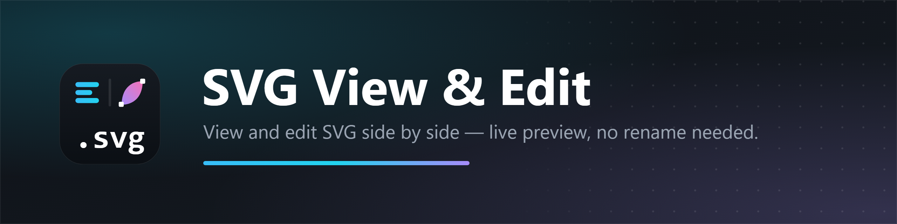

<p align="center">
  
</p>

<p align="center">
  <a href="https://marketplace.visualstudio.com/items?itemName=ITSARMEN.svg-view-edit">
    
  </a>
  <a href="https://marketplace.visualstudio.com/items?itemName=ITSARMEN.svg-view-edit">
    
  </a>
  <a href="https://marketplace.visualstudio.com/items?itemName=ITSARMEN.svg-view-edit">
    
  </a>
</p>

# SVG View & Edit

[**Install from the VS Code Marketplace →**](https://marketplace.visualstudio.com/items?itemName=ITSARMEN.svg-view-edit)

A Visual Studio Code extension that lets you **view and edit SVG files** in one
place. VS Code normally previews `.svg` files as an image, so editing them means
renaming the file to `.xml` first. **SVG View & Edit** removes that step: open an
SVG and edit its source with a live preview right beside it.

## Why

- VS Code shows `.svg` as an image by default — the source is read-only in that view.
- Renaming to `.xml` just to tweak a path, color or size is tedious.
- Switching back and forth between the image preview and the text editor is slow.

## Features

- **Editable source + live preview** — type SVG/XML markup on the left and see the rendered image update instantly on the right.
- **XML syntax highlighting** — the source pane is a real code editor (CodeMirror) with line numbers, bracket matching, search and undo/redo, themed to match VS Code.
- **Split, Source and Preview modes** — switch layouts from the editor header.
- **Opens `.svg` by default** — no more *Reopen Editor With…* every time.
- **One-click alternatives** — open the same file in the built-in text editor or the built-in image preview.
- **Live status bar** — line and character counts while you edit.
- **Follows your theme** — the preview surface adapts to light, dark and high-contrast themes, with an optional checkerboard for transparency.
- **Saves with feedback** — a clear confirmation when your SVG is written to disk.

## Usage

1. Open any `.svg` file — it opens in **SVG View & Edit**.
2. Choose **Source**, **Split** or **Preview** from the header.
3. Edit the markup on the left; watch the preview on the right.
4. Press `Ctrl+S` (or the Save button) to write the file.

From the Explorer context menu or the editor title bar you can also:

- **SVG View & Edit: Open with SVG View & Edit**
- **SVG View & Edit: Open SVG Source** — edit as plain text.
- **SVG View & Edit: Open SVG as Image** — use VS Code's image preview.

## Settings

| Setting | Default | Description |
| --- | --- | --- |
| `svgViewEdit.defaultMode` | `split` | Layout used when an SVG is opened (`split`, `source`, `preview`). |
| `svgViewEdit.preview.checkerboard` | `true` | Show a checkerboard behind the preview to reveal transparency. |

## Requirements

- Visual Studio Code **1.85.0** or newer.

## Development

```bash
npm install
npm run compile     # one-off build into dist/
npm run watch       # rebuild on change
npm run check-types # TypeScript type check
npm run vsix        # package svg-view-edit-x.y.z.vsix
```

Press `F5` in VS Code to launch an Extension Development Host, then open any
`.svg` file.

## License

[MIT](LICENSE) © Amiran Kimadze (itsarmen)
